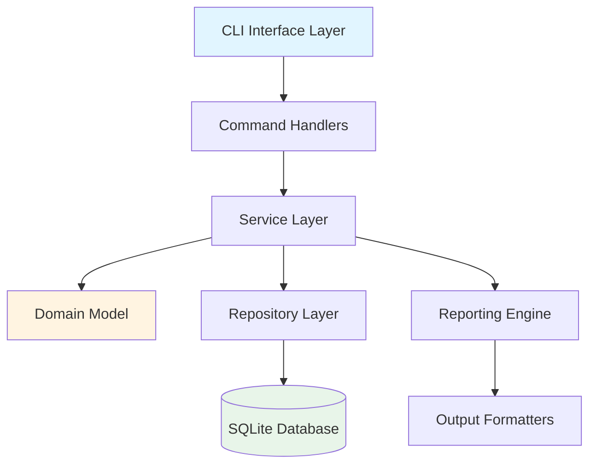
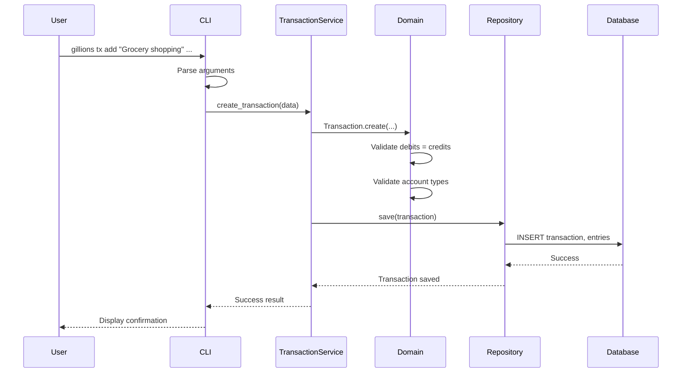

# Gillions - Double-Entry Bookkeeping CLI Application
## Architecture Overview

**Version:** 1.0  
**Last Updated:** 2026-01-24  
**Target Use Case:** Personal Finance Tracking

---

## 1. System Overview

### 1.1 Purpose

Gillions is a command-line double-entry bookkeeping application designed for personal financial management. It implements proper accounting principles to provide accurate, balanced financial tracking for household budgets, expenses, savings, and personal investments.

### 1.2 Core Principles of Double-Entry Bookkeeping

The application is built on fundamental accounting principles:

1. **Every transaction affects at least two accounts** - One account is debited, another is credited
2. **Debits must equal credits** - The accounting equation must always balance
3. **The accounting equation**: `Assets = Liabilities + Equity`
4. **Account types follow standard classifications**:
   - **Assets**: What you own (cash, bank accounts, investments, property)
   - **Liabilities**: What you owe (credit cards, loans, mortgages)
   - **Equity**: Your net worth (initial capital, retained earnings)
   - **Income**: Money coming in (salary, interest, dividends)
   - **Expenses**: Money going out (groceries, rent, utilities)

5. **Debit/Credit Rules**:
   - Assets: Debit increases, Credit decreases
   - Liabilities: Credit increases, Debit decreases
   - Equity: Credit increases, Debit decreases
   - Income: Credit increases, Debit decreases
   - Expenses: Debit increases, Credit decreases

### 1.3 Key Features

- **Transaction Recording**: Record financial transactions with proper double-entry accounting
- **Chart of Accounts**: Hierarchical account structure for organizing finances
- **Balance Reporting**: View account balances and verify books balance
- **Financial Reports**: Generate income statements, balance sheets, and custom reports
- **Data Integrity**: Ensure all transactions balance and maintain audit trail
- **Human-Readable Storage**: Store data in formats that can be backed up and version controlled

---

## 2. Technology Stack

### 2.1 Recommended Stack: Python

**Primary Language:** Python 3.11+

**Justification:**
- **Ease of Development**: Python's clear syntax and extensive standard library accelerate development
- **Data Handling**: Excellent libraries for date/time manipulation, decimal precision (critical for financial calculations)
- **CLI Ecosystem**: Mature CLI frameworks (Click, Typer) with minimal boilerplate
- **Database Support**: Built-in SQLite support, excellent ORM options
- **Maintainability**: Readable code, strong typing support (type hints), good testing frameworks
- **Cross-Platform**: Works seamlessly on macOS, Linux, and Windows
- **Community**: Large ecosystem for financial/accounting libraries

**Alternative Considerations:**
- **Go**: Better performance, single binary distribution, but more verbose for data modeling
- **Rust**: Maximum safety and performance, but steeper learning curve and longer development time
- **Node.js/TypeScript**: Good CLI tools, but less ideal for precise decimal arithmetic

### 2.2 Core Libraries

#### CLI Framework
- **Click** (v8.1+) or **Typer** (v0.9+)
  - Rich command-line interface with subcommands
  - Automatic help generation
  - Parameter validation
  - Typer offers better type safety with Python type hints

#### Data Persistence
- **SQLite3** (built-in)
  - Lightweight, serverless database
  - ACID compliance for data integrity
  - Good query performance for personal finance scale
  - Single file for easy backup
- **SQLAlchemy** (v2.0+)
  - ORM for clean data modeling
  - Migration support via Alembic
  - Query builder for complex reports

#### Data Handling
- **Decimal** (built-in)
  - Precise decimal arithmetic (no floating-point errors)
  - Critical for financial calculations
- **datetime** (built-in)
  - Transaction date/time handling
- **Pydantic** (v2.0+)
  - Data validation and serialization
  - Type-safe configuration
  - JSON schema generation

#### Reporting & Output
- **Rich** (v13.0+)
  - Beautiful terminal output
  - Tables, progress bars, syntax highlighting
  - Color-coded reports
- **Tabulate** (v0.9+)
  - Alternative for simple table formatting
- **Jinja2** (v3.1+)
  - Template engine for report generation

#### Testing
- **pytest** (v7.4+)
  - Unit and integration testing
  - Fixtures for test data
- **pytest-cov**
  - Code coverage reporting

#### Development Tools
- **Black** - Code formatting
- **Ruff** - Fast linting
- **mypy** - Static type checking

---

## 3. Application Architecture

### 3.1 High-Level Architecture



### 3.2 Module Structure

```
gillions/
├── gillions/                    # Main package
│   ├── __init__.py
│   ├── __main__.py             # Entry point for `python -m gillions`
│   ├── cli/                    # CLI interface layer
│   │   ├── __init__.py
│   │   ├── main.py             # Main CLI app and command groups
│   │   ├── account_commands.py # Account management commands
│   │   ├── transaction_commands.py
│   │   ├── report_commands.py
│   │   └── init_commands.py
│   ├── domain/                 # Core domain model
│   │   ├── __init__.py
│   │   ├── account.py          # Account entity and types
│   │   ├── transaction.py      # Transaction and journal entries
│   │   ├── chart_of_accounts.py
│   │   ├── balance.py          # Balance calculations
│   │   └── validators.py       # Business rule validation
│   ├── services/               # Business logic layer
│   │   ├── __init__.py
│   │   ├── account_service.py
│   │   ├── transaction_service.py
│   │   ├── balance_service.py
│   │   └── report_service.py
│   ├── repository/             # Data persistence layer
│   │   ├── __init__.py
│   │   ├── base.py             # Base repository interface
│   │   ├── account_repository.py
│   │   ├── transaction_repository.py
│   │   └── models.py           # SQLAlchemy models
│   ├── reporting/              # Report generation
│   │   ├── __init__.py
│   │   ├── balance_sheet.py
│   │   ├── income_statement.py
│   │   ├── trial_balance.py
│   │   └── formatters.py       # Output formatting (table, JSON, CSV)
│   ├── config/                 # Configuration management
│   │   ├── __init__.py
│   │   ├── settings.py
│   │   └── database.py
│   └── utils/                  # Utility functions
│       ├── __init__.py
│       ├── date_utils.py
│       ├── currency.py
│       └── exceptions.py
├── tests/                      # Test suite
│   ├── unit/
│   ├── integration/
│   └── fixtures/
├── docs/                       # Documentation
├── plans/                      # Architecture and planning docs
├── pyproject.toml              # Project configuration
├── README.md
└── .gitignore
```

### 3.3 Layer Responsibilities

#### CLI Interface Layer
- Parse command-line arguments
- Validate user input
- Format and display output
- Handle user interaction
- No business logic

#### Service Layer
- Orchestrate business operations
- Coordinate between domain and repository
- Transaction management
- Business rule enforcement
- Error handling and validation

#### Domain Model Layer
- Core business entities (Account, Transaction, JournalEntry)
- Business logic and rules
- Domain validation
- Pure Python objects (framework-agnostic)

#### Repository Layer
- Data persistence abstraction
- CRUD operations
- Query building
- Database schema management
- SQLAlchemy ORM mapping

#### Reporting Layer
- Generate financial reports
- Aggregate and calculate data
- Format output (tables, JSON, CSV)
- Template rendering

### 3.4 Data Flow

**Example: Recording a Transaction**



### 3.5 Design Patterns

1. **Repository Pattern**: Abstract data access from business logic
2. **Service Layer Pattern**: Encapsulate business operations
3. **Factory Pattern**: Create complex domain objects
4. **Strategy Pattern**: Multiple output formatters (table, JSON, CSV)
5. **Command Pattern**: CLI commands as discrete operations
6. **Value Objects**: Immutable domain values (Money, AccountCode)

### 3.6 Error Handling Strategy

- **Domain Exceptions**: Business rule violations (e.g., unbalanced transaction)
- **Validation Exceptions**: Invalid input data
- **Repository Exceptions**: Database errors
- **CLI Exceptions**: User input errors

All exceptions propagate to CLI layer for user-friendly error messages.

---

## 4. Key Design Decisions

### 4.1 Why SQLite?

**Chosen over plain text/JSON:**
- ACID compliance ensures data integrity
- Efficient querying for reports
- Built-in transaction support
- Single file for easy backup
- No server setup required
- Good performance for personal finance scale (thousands of transactions)

**Trade-offs:**
- Less human-readable than plain text
- Requires database tools for direct inspection
- **Mitigation**: Provide export commands (JSON, CSV) for data portability

### 4.2 Why Python?

**Chosen over Go/Rust:**
- Faster development for personal finance domain
- Excellent decimal precision support
- Rich ecosystem for CLI and data handling
- Easier maintenance for personal projects
- Strong typing available via type hints

**Trade-offs:**
- Slower runtime performance
- Requires Python runtime (not single binary)
- **Mitigation**: Performance is sufficient for personal finance scale; can package with PyInstaller if needed

### 4.3 Decimal Precision

All monetary amounts use Python's `Decimal` type to avoid floating-point arithmetic errors. This is critical for financial accuracy.

### 4.4 Account Hierarchy

Accounts support hierarchical structure using colon-separated codes:
- `Assets:Bank:Checking`
- `Expenses:Food:Groceries`

This allows for detailed categorization while maintaining flexibility.

---

## 5. Non-Functional Requirements

### 5.1 Performance
- Transaction recording: < 100ms
- Balance calculation: < 500ms for 10,000 transactions
- Report generation: < 2s for annual reports

### 5.2 Data Integrity
- All transactions must balance (debits = credits)
- Database constraints enforce referential integrity
- Audit trail: transactions are immutable once recorded

### 5.3 Usability
- Clear, intuitive command syntax
- Helpful error messages
- Rich terminal output with colors and tables
- Comprehensive help documentation

### 5.4 Maintainability
- Type hints throughout codebase
- Comprehensive test coverage (>80%)
- Clear separation of concerns
- Well-documented code

### 5.5 Portability
- Cross-platform (macOS, Linux, Windows)
- Export to standard formats (CSV, JSON)
- Single database file for easy backup
- Version control friendly configuration

---

## 6. Security Considerations

### 6.1 Data Protection
- Database file stored in user's home directory
- File permissions restricted to user only
- No network access required
- No sensitive data transmitted

### 6.2 Input Validation
- All user input validated before processing
- SQL injection prevented by ORM parameterization
- Amount validation (positive values, proper decimal format)

---

## 7. Future Extensibility

### 7.1 Plugin Architecture
- Custom report generators
- Import/export formats
- Account type extensions

### 7.2 Multi-Currency Support
- Currency conversion
- Foreign exchange tracking

### 7.3 Budget Tracking
- Budget vs. actual reporting
- Spending alerts

### 7.4 Reconciliation
- Bank statement reconciliation
- Mark transactions as cleared

---

## 8. References

- **Double-Entry Bookkeeping**: [Wikipedia](https://en.wikipedia.org/wiki/Double-entry_bookkeeping)
- **Ledger CLI**: Inspiration for plain-text accounting
- **GnuCash**: Reference for personal finance features
- **Accounting Principles**: Standard GAAP/IFRS concepts adapted for personal use
