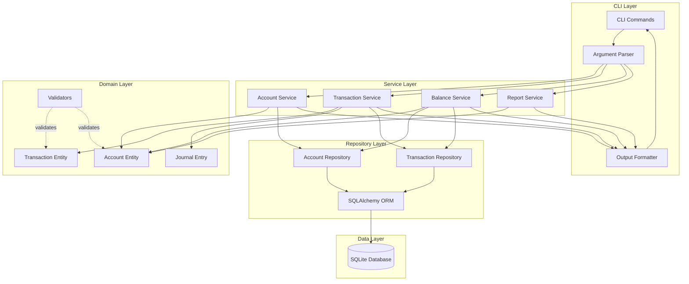

# Gillions - Architecture & Design Documentation

**Project:** Double-Entry Bookkeeping CLI Application for Personal Finance  
**Version:** 1.0  
**Last Updated:** 2026-01-24  
**Status:** Architecture & Design Phase

---

## Overview

Gillions is a command-line double-entry bookkeeping application designed for personal financial management. This directory contains comprehensive architectural documentation created during the design phase.

### Purpose

This application implements proper double-entry accounting principles to provide accurate, balanced financial tracking for:
- Household budgets
- Personal expenses and income
- Savings tracking
- Personal investments
- Net worth monitoring

---

## Documentation Structure

This architecture documentation is organized into the following files:

### 1. [Architecture Overview](architecture-overview.md)
**Primary architectural document covering:**
- System overview and core double-entry bookkeeping principles
- Technology stack selection and justification (Python + SQLite)
- High-level application architecture and module structure
- Design patterns and layer responsibilities
- Data flow and component interactions
- Non-functional requirements
- Security considerations
- Future extensibility

**Start here** for a comprehensive understanding of the system design.

### 2. [Domain Model](domain-model.md)
**Detailed domain model specification including:**
- Core entities (Account, Transaction, JournalEntry)
- Account types and hierarchy structure
- Transaction patterns and business rules
- Value objects (Money, DateRange)
- Domain services (validation, balance calculation)
- Common transaction examples
- Domain invariants and validation rules

**Essential reading** for understanding the business logic and data structures.

### 3. [CLI Interface](cli-interface.md)
**Complete command-line interface specification:**
- Command structure and global options
- All CLI commands with syntax and examples
- Account management commands
- Transaction recording commands
- Reporting and balance commands
- Data export/import commands
- Output formats (table, JSON, CSV)
- Error handling and user experience

**Reference guide** for the user-facing interface design.

### 4. [Data Persistence](data-persistence.md)
**Database schema and storage strategy:**
- SQLite database design and rationale
- Complete database schema with all tables
- Indexes and constraints
- SQLAlchemy ORM models
- Common queries and performance optimization
- Backup and recovery strategy
- Migration strategy
- Data export formats

**Technical reference** for database implementation.

### 5. [Implementation Roadmap](implementation-roadmap.md)
**Development plan and feature prioritization:**
- MVP feature breakdown (v0.1, v0.2, v0.3)
- Development phases with timelines
- Technical implementation order
- Testing strategy and coverage goals
- Documentation plan
- Release strategy and milestones
- Risk mitigation
- Success metrics

**Project management guide** for implementation planning.

---

## Key Architectural Decisions

### Technology Stack

**Language:** Python 3.11+
- Excellent for data handling and decimal precision
- Rich ecosystem for CLI development
- Strong typing support with type hints
- Easy to maintain and extend

**Database:** SQLite 3.35+
- ACID compliance for data integrity
- Zero configuration, single file
- Sufficient performance for personal finance
- Easy backup and portability

**CLI Framework:** Click or Typer
- Rich command-line interface capabilities
- Automatic help generation
- Type-safe parameter handling

**ORM:** SQLAlchemy 2.0+
- Clean data modeling
- Migration support via Alembic
- Query builder for complex reports

### Architecture Patterns

**Layered Architecture:**
```
CLI Layer → Service Layer → Domain Layer → Repository Layer → Database
```

**Key Patterns:**
- Repository Pattern for data access
- Service Layer for business logic
- Domain-Driven Design principles
- Command Pattern for CLI commands
- Strategy Pattern for output formatters

### Core Principles

1. **Double-Entry Bookkeeping:** Every transaction affects at least two accounts
2. **Balance Integrity:** Debits must always equal credits
3. **Immutability:** Transactions are immutable once recorded
4. **Decimal Precision:** All monetary amounts use Decimal type
5. **Data Integrity:** Database constraints and application validation

---

## Quick Start Guide

### For Reviewers

1. **Start with** [`architecture-overview.md`](architecture-overview.md) for the big picture
2. **Review** [`domain-model.md`](domain-model.md) to understand the business logic
3. **Examine** [`cli-interface.md`](cli-interface.md) for user experience design
4. **Check** [`data-persistence.md`](data-persistence.md) for technical implementation
5. **Review** [`implementation-roadmap.md`](implementation-roadmap.md) for development plan

### For Developers

1. **Understand the domain** in [`domain-model.md`](domain-model.md)
2. **Review the architecture** in [`architecture-overview.md`](architecture-overview.md)
3. **Study the database schema** in [`data-persistence.md`](data-persistence.md)
4. **Follow the roadmap** in [`implementation-roadmap.md`](implementation-roadmap.md)
5. **Reference CLI design** in [`cli-interface.md`](cli-interface.md) during implementation

### For Users (Future)

Once implemented, users should refer to:
- User documentation (to be created)
- [`cli-interface.md`](cli-interface.md) for command reference
- Tutorial and examples (to be created)

---

## System Architecture Diagram



---

## MVP Features Summary

### MVP v0.1 - Core Functionality
**Essential features for basic bookkeeping:**
- Initialize system with chart of accounts
- Create and manage accounts
- Record transactions with validation
- View account balances
- List transactions
- Verify data integrity

### MVP v0.2 - Production Ready
**Enhanced features for daily use:**
- Income statement and balance sheet
- Financial summary dashboard
- Export/import data (JSON, CSV)
- Interactive transaction entry
- Rich terminal output
- Transaction search and filtering

### MVP v0.3 - Advanced Features
**Comprehensive personal finance:**
- Budgeting and budget tracking
- Bank reconciliation
- Recurring transactions
- Multi-currency support
- Advanced analytics and reporting

---

## Project Structure (Planned)

```
gillions/
├── gillions/                    # Main package
│   ├── cli/                    # CLI interface layer
│   ├── domain/                 # Core domain model
│   ├── services/               # Business logic layer
│   ├── repository/             # Data persistence layer
│   ├── reporting/              # Report generation
│   ├── config/                 # Configuration management
│   └── utils/                  # Utility functions
├── tests/                      # Test suite
│   ├── unit/
│   ├── integration/
│   └── fixtures/
├── docs/                       # User documentation
├── plans/                      # Architecture docs (this directory)
├── pyproject.toml              # Project configuration
├── README.md                   # Project README
└── .gitignore
```

---

## Development Timeline

**Phase 1: Foundation** (Weeks 1-2)
- Project setup and domain model

**Phase 2: Core CLI** (Weeks 3-4)
- CLI framework and basic commands

**Phase 3: Reporting** (Weeks 5-6)
- Balance calculations and reports

**Phase 4: Enhanced Reporting** (Weeks 7-8)
- Financial statements

**Phase 5: Data Management** (Weeks 9-10)
- Export/import and backups

**Phase 6: Polish** (Weeks 11-12)
- UX improvements and documentation

**Total Estimated Time:** 12-16 weeks to production-ready v0.2

---

## Design Principles

### 1. Correctness First
- All transactions must balance
- Data integrity is paramount
- Extensive validation and testing

### 2. User-Friendly
- Clear, intuitive commands
- Helpful error messages
- Rich terminal output
- Comprehensive documentation

### 3. Data Portability
- Export to standard formats
- Easy backup and restore
- Version control friendly
- No vendor lock-in

### 4. Maintainability
- Clean architecture
- Type hints throughout
- Comprehensive tests
- Well-documented code

### 5. Extensibility
- Plugin architecture (future)
- Modular design
- Clear interfaces
- Separation of concerns

---

## Accounting Fundamentals

### The Accounting Equation
```
Assets = Liabilities + Equity
```

### Account Types & Normal Balances

| Account Type | Normal Balance | Increase | Decrease |
|--------------|----------------|----------|----------|
| Assets       | Debit          | Debit    | Credit   |
| Liabilities  | Credit         | Credit   | Debit    |
| Equity       | Credit         | Credit   | Debit    |
| Income       | Credit         | Credit   | Debit    |
| Expenses     | Debit          | Debit    | Credit   |

### Double-Entry Rule
For every transaction:
```
Sum(Debits) = Sum(Credits)
```

---

## Example Usage (Planned)

### Initialize System
```bash
gillions init --currency USD --template personal
```

### Record Expense
```bash
gillions tx add \
  --description "Grocery shopping" \
  --debit "Expenses:Food:Groceries" 85.50 \
  --credit "Assets:Bank:Checking" 85.50
```

### View Balance
```bash
gillions balance --account "Assets:Bank:Checking"
```

### Generate Report
```bash
gillions report income-statement --period month
```

---

## Success Criteria

### Functional Requirements
✓ Record all personal finance transactions  
✓ Maintain balanced books (debits = credits)  
✓ Generate standard financial reports  
✓ Export/import data reliably  

### Quality Requirements
✓ >80% test coverage  
✓ No critical bugs  
✓ Clear error messages  
✓ Comprehensive documentation  

### Performance Requirements
✓ Transaction recording < 100ms  
✓ Balance calculation < 500ms for 10K transactions  
✓ Report generation < 2s  

---

## Next Steps

### For Architecture Review
1. Review all documentation files
2. Provide feedback on design decisions
3. Suggest improvements or alternatives
4. Approve architecture before implementation

### For Implementation
1. Set up development environment
2. Create project structure
3. Implement Phase 1: Foundation
4. Follow test-driven development
5. Iterate based on testing and feedback

### For Questions
- Review specific documentation files
- Check examples in domain model
- Refer to CLI interface for command syntax
- Consult implementation roadmap for timeline

---

## References & Inspiration

- **Ledger CLI:** Plain-text accounting inspiration
- **GnuCash:** Personal finance feature reference
- **hledger:** Haskell-based accounting tool
- **Beancount:** Python-based accounting tool
- **GAAP/IFRS:** Standard accounting principles

---

## Document Maintenance

### Version History
- **v1.0** (2026-01-24): Initial architecture documentation

### Review Schedule
- Architecture review before implementation
- Update as design evolves
- Maintain alignment with implementation

### Contact
For questions or clarifications about this architecture, please refer to the specific documentation files or create an issue in the project repository.

---

## License

This architecture documentation is part of the Gillions project. License to be determined.

---

**Note:** This is architecture and design documentation. No code has been implemented yet. This documentation serves as the blueprint for implementation.
